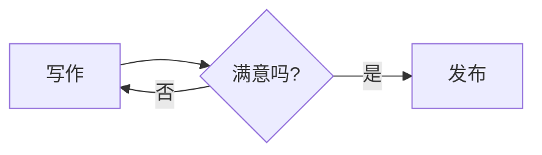

# 欢迎使用 Plume

Plume 是一个**所见即所得**的 Markdown 编辑器：输入 Markdown 语法，内容会*立即*渲染；把光标移进某个元素时，它的源码标记会重新出现，方便修改。

## 快速上手

- 输入 `# ` 加空格开始一个标题，`## ` 是二级标题
- 用 `**粗体**`、`*斜体*`、`~~删除线~~`、`==高亮==` 和 `` `行内代码` ``
- 按 <kbd>⌘</kbd> + <kbd>/</kbd> 在**即时渲染**和**源码模式**之间切换
- 按 <kbd>⌃</kbd> + <kbd>⌘</kbd> + <kbd>S</kbd> 显示或隐藏侧边栏（文件树和大纲）
- 直接把图片粘贴或拖进来，会自动保存到文档旁边的 `assets` 文件夹
- 按住 <kbd>⌘</kbd> 点击链接可以打开它

> 提示：所有修改都会自动保存。用「文件 → 恢复到」可以浏览历史版本。

## 列表与任务

1. 有序列表
2. 第二项
   - 嵌套的无序列表
   - 另一项

- [x] 写一个 Markdown 编辑器
- [ ] 用它写点东西

## 代码

```swift
import Foundation

struct Greeter {
    let name: String
    func greet() -> String { "你好，\(name)！" }
}

print(Greeter(name: "Plume").greet())
```

## 表格

| 功能 | 快捷键 | 说明 |
| :--- | :---: | --- |
| 粗体 | ⌘B | 选中文字后加粗 |
| 链接 | ⌘K | 插入超链接 |
| 表格 | ⌥⌘T | 插入表格 |
| 代码块 | ⌥⌘C | 插入代码块 |

## 数学公式

行内公式 $E = mc^2$，以及块级公式：

$$
\int_{-\infty}^{\infty} e^{-x^2} \, dx = \sqrt{\pi}
$$

## 图表



## 脚注

Plume 基于开源的 Vditor 编辑引擎[^1]。

[^1]: Vditor 采用 MIT 许可证发布。

---

开始写作吧 ✍️
